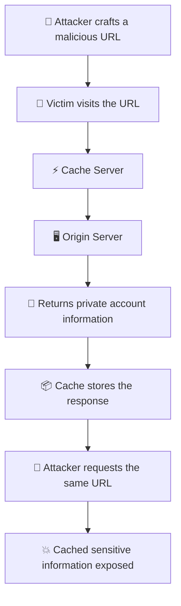

<div align="center">

# 🌐 Web Cache Deception

### Understanding the Hidden Risks Behind Web Caching


**What happens when a website's cache misunderstands what it's storing?**

Welcome to my Web Cache Deception research and learning repository, where I explore how differences between cache servers and origin servers can expose sensitive information.

[📚 Start Learning](https://portswigger.net/web-security/learning-paths/web-cache-deception) • [🔬 Explore the Vulnerability](https://portswigger.net/web-security/web-cache-deception) • [🛡️ Web Security Academy](https://portswigger.net/web-security)

</div>

---

## 👋 Welcome!

Imagine logging into a website and viewing your personal information.

Your account details are private, and only you should be able to access them.

But what if the website accidentally stores your private information in a shared cache?

What if another person can retrieve that information simply by requesting the same URL?

**That's Web Cache Deception (WCD).**

This repository is dedicated to understanding this vulnerability from the ground up, exploring its underlying mechanisms, investigating different exploitation techniques, and learning how caching inconsistencies can create serious security risks.

Whether you're new to web security or already familiar with HTTP, there's something to explore here.

---

## 🧠 What Is Web Cache Deception?

Web Cache Deception is a web security vulnerability in which an attacker tricks a caching system into storing sensitive, user-specific information that should never have been publicly accessible.

The vulnerability occurs because the **cache server and origin server interpret the same URL differently.**

To understand it, let's look at the two main components.

| Component | Responsibility |
|---|---|
| 🖥️ Origin Server | Processes requests and generates application responses, including sensitive user information. |
| ⚡ Cache Server | Stores selected responses and delivers them to users when requested again. |

Normally, these components work together to deliver content efficiently.

However, when they disagree about what a URL represents, sensitive information can accidentally become cached.

---

## 🔍 How Does It Work?

Let's understand the concept through a simple example.

Suppose an authenticated user accesses:

```http
https://example.com/my-account
```

The origin server returns the user's private account information.

An attacker modifies the URL:

```http
https://example.com/my-account/profile.css
```

Now something interesting happens:

- **Origin Server:** Interprets the request as `/my-account` and returns private account information.
- **Cache Server:** Sees `.css` and assumes the request is for a static stylesheet.

If the cache stores the response, the sensitive account information may become accessible to another user.

### The Attack in Action



**The important point:** The cache thinks it is storing a harmless static resource, but the actual response contains private information.

---

## 🧩 What Will You Explore?

Web Cache Deception involves several interesting technical concepts.

<details>
<summary>🔹 Path Mapping Discrepancies</summary>

Different servers and frameworks can map the same URL to different application resources.

This can allow a URL that appears to reference a static file to return dynamic account information.

</details>

<details>
<summary>🔹 Delimiter Discrepancies</summary>

Different components may interpret special characters differently.

These differences can cause the origin server to process only part of a URL while the cache continues interpreting the complete path.

</details>

<details>
<summary>🔹 URL Normalization</summary>

URL normalization involves converting different URL representations into a standardized format.

Differences in decoding characters and resolving path traversal sequences can create opportunities for exploitation.

</details>

<details>
<summary>🔹 Cache Keys and Cache Rules</summary>

Cache keys determine how responses are identified and retrieved.

Cache rules determine which resources should be stored.

Misconfigured rules can cause sensitive dynamic responses to be treated as cacheable content.

</details>

<details>
<summary>🔹 Cache Server Behavior</summary>

Understanding how caching infrastructure interprets URL paths, file extensions, directory prefixes, and specific filenames is essential when investigating Web Cache Deception.

</details>

---

## 🎯 Why Does This Matter?

Web caching is designed to improve performance, but incorrect configurations can introduce security vulnerabilities.

Successful exploitation may lead to:

- 🔓 Sensitive information disclosure.
- 👤 Exposure of personal account information.
- 🔑 Leakage of API keys and other confidential data.
- 🔄 Cross-user data exposure.
- ⚠️ Further attacks when exposed information can be used in other vulnerabilities.

Web Cache Deception also demonstrates how seemingly minor differences in request processing can have significant security consequences.

---

## 🧪 Practical Labs & Experiments

Theory becomes more meaningful when you can reproduce vulnerabilities yourself.

This section contains my hands-on experiments from PortSwigger Web Security Academy, documenting the vulnerability analysis, exploitation methodology, payloads, observations, and lessons learned.

**Progress: 5 Experiments Completed**

| # | Lab | Difficulty | Status |
|---|---|---|---|
| 01 | [Exploiting Path Mapping](Labs/Lab-01-Exploiting-Path-Mapping/) | Apprentice | 🟢 Solved |
| 02 | [Exploiting Path Delimiters](Labs/Lab-02-Exploiting-Path-Delimiters/) | Practitioner | 🟢 Solved |
| 03 | [Exploiting Origin Server Normalization](Labs/Lab-03-Exploiting-Origin-Server-Normalization/) | Practitioner | 🟢 Solved |
| 04 | [Exploiting Cache Server Normalization](Labs/Lab-04-Exploiting-Cache-Server-Normalization/) | Practitioner | 🟢 Solved |
| 05 | [Exploiting Exact-Match Cache Rules](Labs/Lab-05-Exploiting-Exact-Match-Cache-Rules/) | Expert | 🟢 Solved |

<details>
<summary>🔍 Explore the experiments</summary>

**Experiment 01 — Path Mapping**

Understanding how differences in URL-to-resource mapping can cause sensitive dynamic responses to be cached.

**Experiment 02 — Path Delimiters**

Investigating how different interpretations of delimiter characters can create cache discrepancies.

**Experiment 03 — Origin Server Normalization**

Exploiting differences in how the origin server decodes and normalizes URL paths.

**Experiment 04 — Cache Server Normalization**

Investigating how cache-side normalization combined with delimiter discrepancies can expose sensitive information.

**Experiment 05 — Exact-Match Cache Rules**

Exploring how exact filename caching rules can be exploited and chained with CSRF to perform an unauthorized account modification.

</details>

---

## 🛠️ Tools & Technologies

| Tool | Purpose |
|---|---|
| Burp Suite | Intercepting and analyzing HTTP traffic. |
| Burp Proxy | Monitoring application requests and responses. |
| Burp Repeater | Testing URL variations and caching behavior. |
| Burp Intruder | Automating delimiter and payload testing. |
| Browser Developer Tools | Inspecting network requests and HTTP headers. |
| cURL | Sending customized HTTP requests. |

---

## 🚀 The Learning Journey

This repository is built around a hands-on learning approach.

Rather than simply collecting payloads, the objective is to understand the reasoning behind each vulnerability.

1. **Understand** — Learn how web caching works.
2. **Investigate** — Examine how the cache and origin server process requests.
3. **Identify** — Discover inconsistencies in URL interpretation.
4. **Exploit** — Reproduce vulnerabilities in controlled environments.
5. **Analyze** — Understand the security impact of successful exploitation.
6. **Defend** — Explore mitigation strategies and secure caching configurations.

Every practical exercise is an opportunity to understand another aspect of web application security.

---

## 📚 Start Learning

Ready to explore Web Cache Deception?

PortSwigger Web Security Academy provides structured learning materials and interactive labs to help you understand and practice these vulnerabilities.

<div align="center">

### 🔬 Web Cache Deception — Learning Path

[](https://portswigger.net/web-security/learning-paths/web-cache-deception)

[Explore the official Web Cache Deception topic](https://portswigger.net/web-security/web-cache-deception)

</div>

---

## 🛡️ The Bigger Picture

Web security isn't just about finding vulnerabilities. It's about understanding why they exist, how different components interact, and what happens when those interactions go wrong.

Web Cache Deception is a great example of how a performance optimization mechanism can become a security weakness.

**Understand the request. Question the response. Never trust the cache blindly.**

---

<div align="center">

### 💻 Learn. Experiment. Understand. Secure.

**Thanks for visiting!**

If you're interested in web application security, feel free to explore this repository and follow the learning journey.


</div>

---

### ⚠️ Disclaimer

This repository is maintained for educational and cybersecurity research purposes.

All practical exploitation activities are performed within PortSwigger Web Security Academy's intentionally vulnerable lab environments.

Never test these techniques against systems without explicit authorization.
